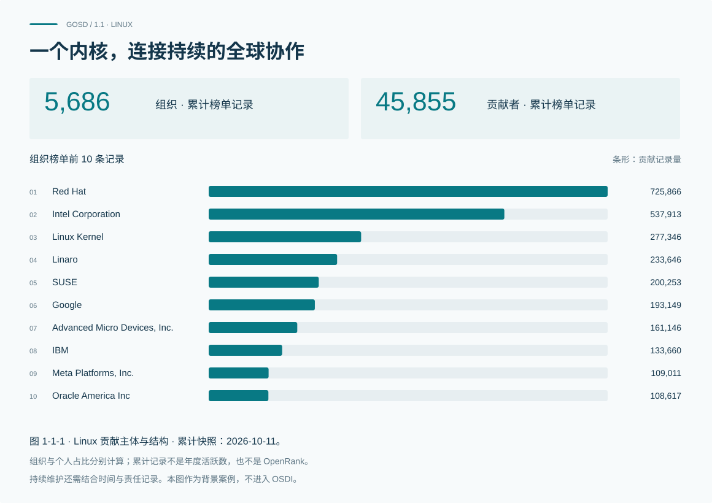
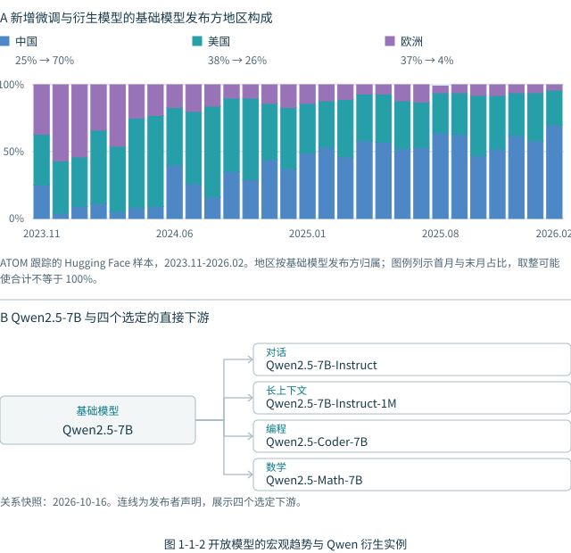
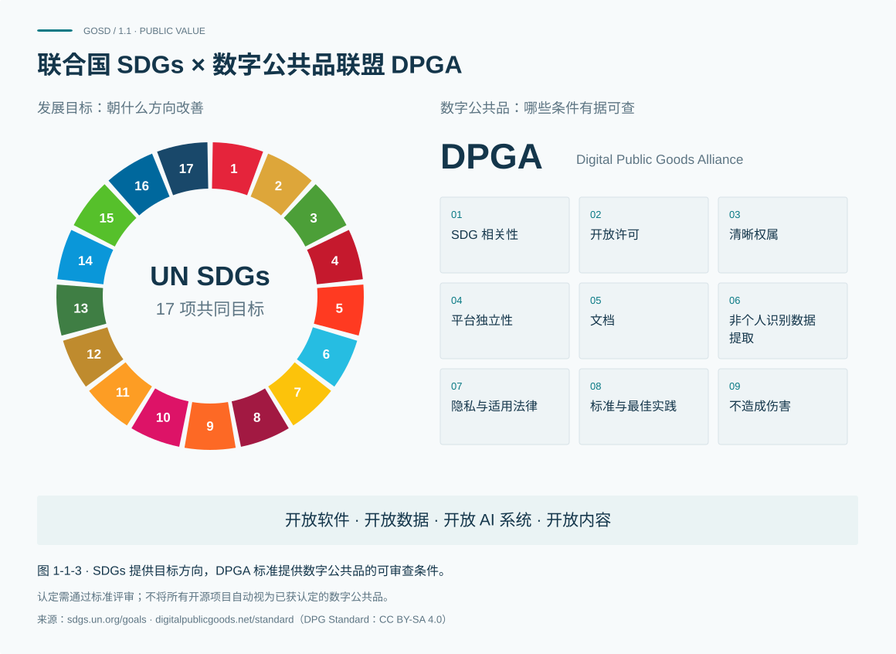

# 1.1 开源 共同创新与公共价值

## 从一次发布到持续创造

一项技术成果公开发布，是开放协作的起点。此后仍需要有人回应问题、审查修改、修复缺陷和维护文档，也需要让新的参与者逐步理解项目并承担工作。成果能否被持续使用，取决于这些日常贡献能否延续。Linux 为理解这种共同维护提供了一个具体入口。

报告采集的 LFX Linux Kernel 累计快照记录了 45,855 位贡献者与 5,686 个组织条目，采集时点为 2026 年 10 月 11 日。图 1-1-1 分别展示组织与贡献者的前十条记录。组织榜单中，Red Hat 的贡献记录量为 725,866，占该榜单统计总量的 14.95%；Intel Corporation 为 537,913，占 11.08%。贡献者榜单中，David S. Miller 的记录量为 236,673，占该榜单统计总量的 3.73%。

这两类榜单提供了互补的观察尺度：组织记录使资源投入与机构参与更可见，个人记录则把具体贡献者带入视野。来源中的“组织”是平台归集的条目，不能直接等同于企业；“贡献记录量”也应按来源定义理解，不能改称代码行数、OpenRank 或经济价值。组织与个人采用不同的统计分母，二者的占比不能相加，榜单记录也不能直接互相换算。

**共同维护，让成果能够延续。**累计榜单首先告诉我们“谁留下了贡献记录”，并为研究协作结构提供入口。它不能独立证明每位参与者在当年仍然活跃，也无法仅凭一个时点判断维护责任是否稳定。要回答这些问题，还需结合跨期活动、审查与发布记录，以及维护者分工等材料。

这一案例提示我们，支持开源不能只围绕新项目和新版本展开。文档改进、问题响应、版本维护和参与者成长，同样需要长期投入。第二章对参与和协作格局的观察、第三章对贡献主体的比较，将沿着这一思路展开；规模与排行是认识生态的起点，持续参与和责任延续是需要继续追踪的问题。

## 从代码协作到模型与数据的再创造

开放的影响也会沿着后续开发延伸。在模型生态中，基础模型可以成为指令微调、领域适配和其他开发活动的起点，后续成果又可能支持新的使用场景。共同改进一个成果，以及基于已有成果继续创造，构成两种相互补充的协作方式。后一种关系提醒我们：一项成果的影响，可能超出它自身的发布页面。

图 1-1-2 的宏观部分展示 ATOM 跟踪的 Hugging Face 样本。2023 年 11 月至 2026 年 2 月，新增微调与衍生模型所采用的基础模型，其发布方地区构成持续变化。样本起点，中国发布方占 25%、美国占 38%、欧洲占 37%；到 2026 年 2 月，三者分别为 70%、26% 和 4%。中间月份存在多次波动，期末差异不能被读成一条持续、匀速增长的路径。

这里观察的是基础模型在新增衍生中的构成，归属指基础模型发布方，不是下游用户国籍。占比上升说明其在该样本当月构成中的位置变化，不能仅据此判断衍生总量增长了多少、模型性能孰优，或整个市场由谁主导。原始百分比按来源保留，个别月份分项之和因取整并非恰好 100%。

局部实例让这种复用关系更加具体。第五章保留的 2026 年 10 月 16 日平台关系快照中，Qwen2.5-7B 与 Qwen2.5-7B-Instruct、Qwen2.5-7B-Instruct-1M、Qwen2.5-Coder-7B、Qwen2.5-Math-7B 之间存在基础模型声明关系，分别连接对话、长上下文、编程和数学等用途。图中选取这四条直接关系，说明一次发布如何与后续创造相联系；它既不是该模型的完整下游清单，也不用于解释宏观图中的地区份额。

**可复用的成果，连接下一次创造。**这些连线记录的是发布者声明，并不验证实际训练过程，也不分配各方贡献比例。宏观样本与局部实例采用不同时间和范围：前者帮助观察构成变化，后者帮助理解关系含义，二者不能直接拼接成因果解释。

复用还依赖开放条件。能下载模型权重，不意味着训练数据、训练代码和评估材料都可获得；能运行模型，也不意味着使用、修改和分发没有条件。因此，模型数量、复用关系与开放程度需要分别观察。第五章以供给、网络与开放分级三个小节展开这些问题，将“发布了什么”进一步连接到“如何被继续使用与创造”。

## SDGs 与数字公共品：连接发展目标与实践条件

教育、科研和公共服务可以采用开放成果，但技术可获得与实际受益之间，还存在使用条件、维护能力和本地适配等环节。对公共投入而言，值得追问的不只是发布了多少成果，还包括谁能够使用、谁承担维护，以及受益能否持续。公共价值需要沿着使用过程继续观察。

联合国可持续发展目标（SDGs）提供共同的发展方向。优质教育、产业与创新、减少不平等、有效治理和伙伴关系等议题，帮助我们提出“希望改善什么”的问题。将开源与这些目标联系起来，是为了明确研究和行动的方向；具体项目是否改善了某项发展结果，仍需相应场景中的证据。

数字公共品联盟（DPGA）的标准从另一侧回答“需要具备什么条件”。九项要求涵盖 SDG 相关性、开放许可、清晰权属、平台独立性、文档、非个人识别数据提取、隐私与适用法律、标准与最佳实践，以及不造成伤害。图 1-1-3 将十七项目标与九项条件并列呈现，作为理解发展方向和实践要求的两个入口，二者不作逐项对应。

**发展目标、开放条件与实际成效，需要分别判断。**与 SDGs 相关，不等于已获得数字公共品认可；通过标准评审，说明核心解决方案符合相应要求，仍不能替代对地方实施成效的验证。本报告借鉴目标与条件组织研究，不意味着联合国或 DPGA 对本报告框架、指标和排名的认证。

例如，开放的教育软件可以提供复用基础，但学习者能否受益，还取决于语言适配、设备可及、教师支持和持续维护。这是理解证据链的示例，不是本报告已经验证的项目成效。观察公共价值，需要把技术供给、采用条件和实际结果分别记录，再审慎解释它们之间的联系。

## 将持续共同创造作为观察重点

Linux 让贡献主体和维护问题进入视野，模型实例让下游复用关系更加具体，SDGs 与数字公共品则把这些技术活动连接到发展方向和实践条件。三者共同提示：开放的价值在参与、维护、使用与再创造中逐步形成，需要持续观察。

本报告据此提出三项共同任务：支持持续参与与人才成长，建设可维护、可复用的开放技术基础，推进透明治理与可验证的公共价值。它们是统筹后续研究与行动的方向，而非由三个案例直接推导的量化结论。下一节将这些方向展开为发展目标，第六章再结合各章证据，说明政府、企业与社区可以承担的行动。
