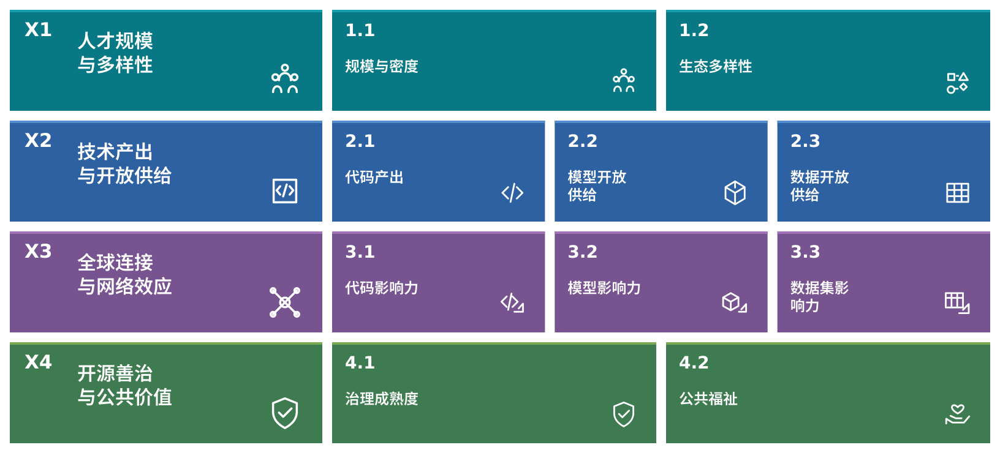

# 1.2 OSDGs：面向智能时代的开源发展目标框架

> **本节问题：** 怎样把开源的公共价值转化为参与者能够共同讨论、持续观察的发展目标？

## 1. 从全球发展议程到开源研究问题

联合国 SDGs 提供了跨国家、跨领域讨论发展的共同语言，其目标与指标相配合的方式，也为开源生态研究提供了方法启发。[1] 本报告提出的**开源发展目标（Open Source Development Goals，OSDGs）**，是一套面向智能时代的开源可持续发展目标框架，关注数字治理、技术普惠与公共价值。

OSDGs 将这一方向转化为四个可以持续追问的问题：谁能够参与？哪些技术成果可以被共同使用？这些成果怎样连接全球创新？协作又如何得到负责任的治理与持续维护？这些问题共同构成从规模增长走向高质量发展的价值坐标。

OSDGs 是本报告提出的研究框架。它借鉴并关联 SDGs，服务于相关发展议题；本报告的指标与联合国官方 SDG 指标分别维护，也不将这种关联写成联合国对框架的采用或认证。

## 2. 四大支柱与十个维度

**图 1-2-1：OSDGs 目标框架。** 使用 [OSDG / OSDI 品牌资产库 v1.0](https://github.com/X-lab2017/osdg-brand/tree/ad441ae810f878bcd53956da1f1b889b0defa45c)的中文框架母版。四个支柱分别包含 2／3／3／2 个维度；图块表示分类结构，不表示权重或评分。

| 支柱 | 目标内涵 | 二级维度 | AI 时代需要观察的变化 |
|---|---|---|---|
| **X1 人才规模与多样性** | 让更多参与者能够进入、协作并成长 | 1.1 规模与密度；1.2 生态多样性 | 人才规模、参与分布、新人进入及跨地区、跨机构协作 |
| **X2 技术产出与开放供给** | 扩大有质量、可复用的开放技术供给 | 2.1 代码产出；2.2 模型开放供给；2.3 数据开放供给 | 代码、模型、数据的供给结构及开放条件 |
| **X3 全球连接与网络效应** | 促进成果流动、采用与进一步创造 | 3.1 代码影响力；3.2 模型影响力；3.3 数据集影响力 | 贡献关系、跨项目连接、模型派生与数据复用 |
| **X4 开源善治与公共价值** | 为持续协作建立治理基础和公共利益方向 | 4.1 治理成熟度；4.2 公共福祉 | 治理主体、许可、公共品共建及 AI 资产透明度 |

**表 1.2.1：四大支柱与十个维度。** 统一中英文命名见[指标字典](../../data/meta/osdi_indicator_dictionary.csv)。

四个支柱相互联系，但不能互相代替。参与人数增加，并不自动意味着贡献质量提高；发布资产更多，也不直接说明它们得到有效复用；网络影响扩大，同样需要与治理责任和公共价值一起审视。因此，本报告同时观察规模、结构、连接和治理，保留不同维度之间的张力。

## 3. 与 SDGs 的关联：明确路径，也保留证据边界

下表从二十九项指标的 SDG 关联中汇总支柱层面的对应关系，并说明其研究逻辑。它回答“为什么值得观察”，实际公共效果则需要结合具体场景进一步验证。

| 支柱 | 当前指标关联的 SDGs | 关联逻辑 | 解释边界 |
|---|---|---|---|
| X1 人才规模与多样性 | 4、8、9、10、11、17 | 从教育与能力、创新参与、地区分布和伙伴关系理解人才生态 | 开发者增多不直接等于就业或公平改善；没有可靠数据时不推断性别等人口特征 |
| X2 技术产出与开放供给 | 9、10、17 | 观察创新基础、供给多样性及协作产出 | 发布量不等于技术质量、使用效果或完整开放 |
| X3 全球连接与网络效应 | 8、9、10、11、12、17 | 观察知识流动、地区连接、技术复用及共同创新 | 网络影响与复用是过程信号，不直接折算为社会收益 |
| X4 开源善治与公共价值 | 9、10、16、17 | 观察治理制度、公共资产与合作机制 | 基金会托管或许可标签均不能单独证明治理质量与公共成效 |

**表 1.2.2：OSDGs 与 SDGs 的研究关联。** 具体指标关联见 1.3 节。SDG 5、7、13 等仍可作为拓展研究与案例方向；目前的二十九项指标不据此宣称已测得性别平等、清洁能源或气候效果。

## 4. 从目标框架到研究与行动

OSDGs 的用途，是帮助不同主体把关注的问题放到共同框架中，并找到适合的证据和行动入口。

| 使用者 | 可提出的问题 | 可以形成的工作 |
|---|---|---|
| 政府与公共部门 | 参与机会、技术供给与跨地区合作怎样变化？ | 结合区域证据开展能力建设和合作政策研究 |
| 企业与技术机构 | 对开放生态的贡献表现在哪里，关键依赖有哪些？ | 改进贡献实践、维护投入与技术选型 |
| 社区与基金会 | 参与、维护和治理是否具有可持续性？ | 识别协作瓶颈，完善社区规则和维护机制 |
| 研究机构与国际组织 | 不同地区和技术生态之间哪些经验可以比较？ | 以可追溯数据开展研究、对话与合作试点 |

**表 1.2.3：框架的应用路径。** 这些是拟支持的使用场景，不代表相关机构已实际采用本体系。

全书四个核心研究板块共同使用这一框架：GOSO 描绘生态格局，GOSR 分析贡献与影响，GOSL 解释技术生态结构，GOSM 研究模型的开放供给与复用。一个板块可以调用多个支柱的指标，具体对应关系见[章节—指标映射](../../data/meta/chapter_indicator_map.csv)。第六章在已有证据范围内提出行动建议，并保留适用对象与局限。

目标框架给出了研究的方向。下一节将通过 OSDI 把方向转化为指标、数据与可追溯的计算规则，使“看见变化—理解原因—形成行动”能够在同一套研究基础上衔接。

## 资料与口径

1. 联合国，[17 项可持续发展目标](https://sdgs.un.org/goals)、[全球指标框架](https://unstats.un.org/sdgs/indicators/indicators-list/)、[指标元数据](https://unstats.un.org/sdgs/metadata/)。目标关联由本报告研究团队解释，不替代联合国官方指标定义。
2. 本报告框架沿用最新确认的四支柱、十维度、二十九指标版本，视觉来源与版本见[图件说明](../../figures/chapter1/README.md)。

返回[本章导读](本章介绍.md) · 上一节：[开源的公共价值](1.1-开源-数字公共品与可持续发展引擎.md) · 下一节：[OSDI 指标体系](1.3-OSDI-开源发展度量体系.md)。
