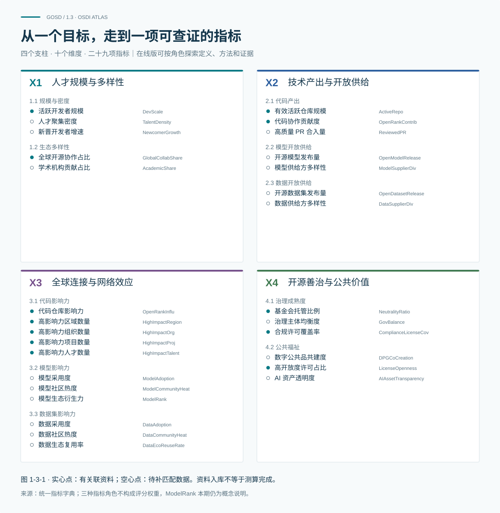

# 1.3 OSDI 指标、证据与观察方法

## 1.3.1 用指标理解发展

OSDI 将四大支柱、十个维度展开为二十九项指标，从参与规模、开放供给、连接与复用、治理与公共价值等方面观察开源发展。

这些指标分为三类：北极星指标关注核心发展结果，驱动指标跟踪相关活动和投入，诊断指标帮助解释差异与约束。三类指标各有用途，不直接加总为一个总分。一个地区、组织或项目在不同维度上的表现，共同构成对它的理解。

## 1.3.2 从参与、贡献到影响与开放

读懂后续图表，可以先分清四个问题：谁在参与，贡献了什么，形成了怎样的影响，以及成果开放了什么、允许怎样使用。活跃人数、贡献量、影响力和开放等级分别回答这些问题，需要结合起来看。

代码生态的观察以 OpenDigger 的工具与指标为基础。OpenRank 通过协作网络刻画影响：社区 OpenRank 关注项目内部，全域 OpenRank 观察更广泛的开发者与仓库网络。按贡献者地域汇总，反映贡献来自哪里；按项目归属汇总，反映哪些主体的项目具有影响。两者各有统计对象，不能互相替代。

模型生态进一步关注供给、复用与开放。模型和数据集记录展示资产积累，基础模型声明关系展示后续创造，ModelRank 提供网络影响的观察。本期纳入了 2024 年 7 月至 2026 年 8 月共 26 个月的 ModelRank 资料；这些排名不代表模型能力测试，算法的独立复现仍需核验。

开放程度则单独评估。第五章依据 SJ/T 12304—2026《人工智能 关键基础技术 大模型技术体系开源开放分级评估规范》，分别介绍材料开放与许可开放。材料等级需满足本级及前置等级要求，许可条件另行判断。标准已发布，将于 2026 年 12 月 1 日实施；平台已有样本标签保留原评估版本，不视为本报告已按发布版标准重新评级。

## 1.3.3 在共同范围内比较，带着问题进入观察

比较之前，先确认对象、时间和范围。报告年度为上年 7 月 1 日至当年 6 月 30 日；自然年、月度与平台快照按图中标注阅读。当前样本按创建时间回溯的趋势，只反映样本内资产的积累，不能完整还原历史存量。

开发者、仓库、模型版本和发布组织是不同的统计单位。份额与排名只在明确的比较集合中成立，未知归属单列。下载量不等于实际用户数，仓库数不等于独立模型家族数，开放等级也不代表性能、安全性或社会效益。

指标有定义、数据已入库、图表已使用、计算可复现，是分别记录的状态。观测、派生、模拟与预测也逐图区分；模拟和预测用于展示与探索，不作为事实性排名或政策优先级的实证依据。治理与公共价值尤其需要结合具体场景、维护责任和受益结果来判断。

带着这些问题，第二章从七个主题观察全球与中国的生态，第三章识别贡献与影响主体，第四章展开技术结构，第五章观察模型的供给、复用与开放，第六章汇聚共同任务与主体行动。全书最终关心的是：更多人能否持续参与，共同创造的成果能否得到维护和继续使用，其公共价值能否被验证与改进。
