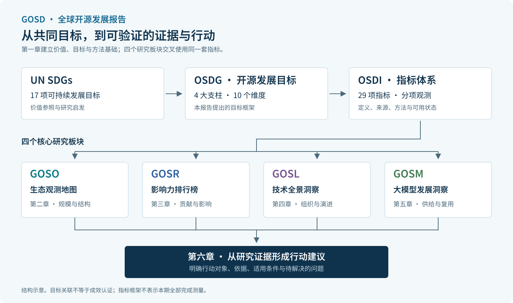

# 第一章 从开放协作到公共价值

引言提出共同愿景，本章进一步讨论：开放如何支持持续创造，我们希望推动什么发展，又如何通过证据观察这些变化。

开源的价值，既体现在更多人能够参与，也体现在成果能够被维护、复用，并成为下一次创造的起点。我们从 Linux 和开放模型两个案例出发，理解这一过程，再通过 OSDGs 明确发展目标，通过 OSDI 组织观察。

宣言的七项原则表达共同价值，OSDGs 的四大支柱组织发展目标，OSDI 的二十九项指标定义具体观察。它们相互衔接，不作逐项对应，也不合成为一个总分。

第二至第五章分别从生态格局、贡献主体、技术结构和模型生态展开研究，第六章将证据连接到共同任务与主体行动。读者可以顺序阅读，也可以沿图中的章节入口选择关心的问题。
