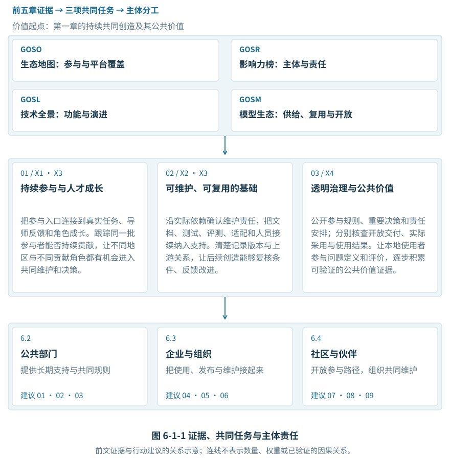
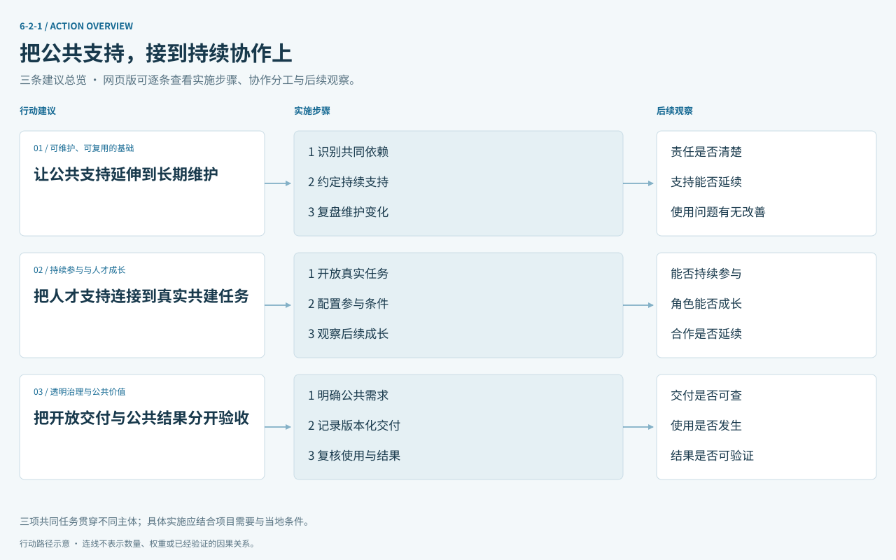
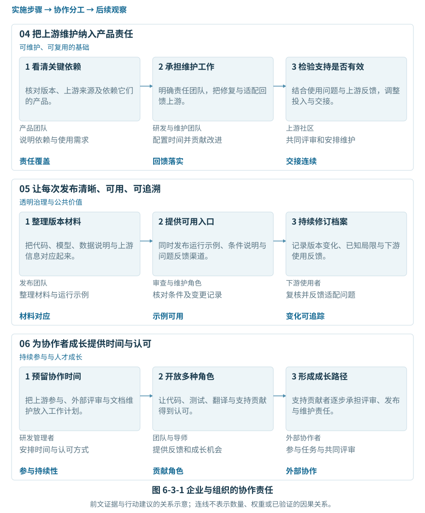
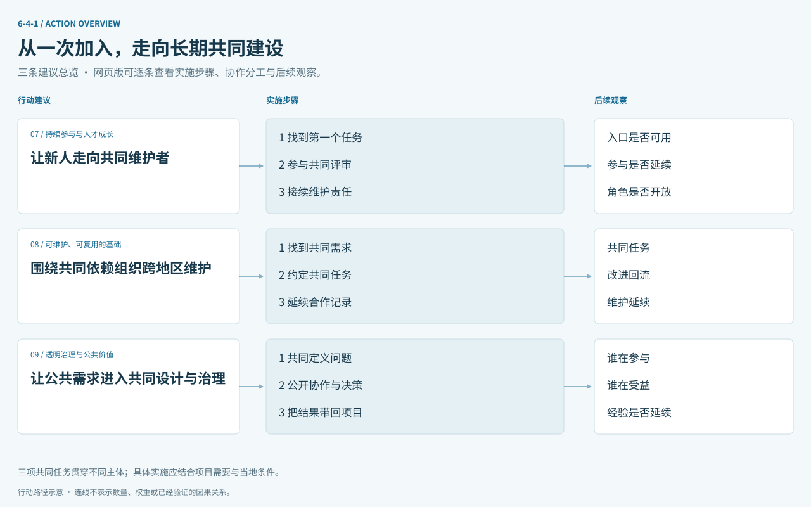
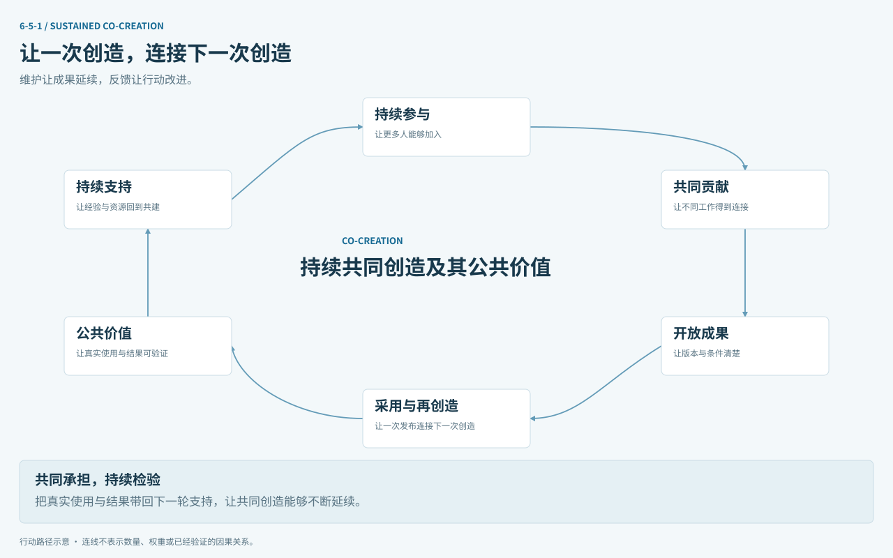

# 第六章 未来展望与行动建议

把不断扩大的参与，转化为持续共同创造。

第一章以“持续共同创造及其公共价值”确立共同方向，2.1 从参与规模与地域分布展开观察，随后各章追踪贡献、影响、技术分工和模型复用。本章沿着这条线索，提出三项共同任务和九条行动建议：让更多人能够留下来，让开放成果得到持续维护，让实际使用与公共结果可以检验。

本章回到 OSDGs 的四大支柱，将人才、开放供给、全球连接、治理与公共价值落实到共同工作。OSDI 的二十九项指标提供观察框架；以下跟踪项用于组织行动复盘，不另行合成总分。

本章综合前文证据提出行动方向，沿用各节的统计范围与时间窗口。建议的实施和成效，需要在具体项目与当地条件下持续检验。

## 6.1 核心洞察与趋势展望

怎样把参与基础的增长，转化为可以延续的协作与公共价值？

前五章逐步展开了同一个问题：谁能够参与，形成了什么贡献，哪些主体和技术环节连接这些工作，开放成果又怎样支持后续创造。综合来看，参与入口、维护责任和使用条件需要同时建设。规模、位次与开放程度各自提供线索，持续共同创造则需要沿着人、成果和使用过程继续追踪。

### 6.1.1 参与呈现多中心格局，长期协作需要继续培育

2.1 显示，2026 报告年度 GitHub 全球活跃开发者约 2,890.36 万；印度、巴西和印度尼西亚合计约占 18.2%。按编制组五域统计，美国、欧洲和中国的开发者总量均接近 3,000 万。两组观察分别说明，已有中心与不断扩大的参与力量共同构成了全球共建基础。

平台覆盖也影响哪些参与能够被看见。2.1 在国家比较中单列国内平台补充量，五域综合统计则保持自身范围。这提示后续研究完善跨平台覆盖与去重；行动上，应以区域节点、真实任务和导师支持连接更多参与者，尤其让全球南方伙伴进入共同维护与决策。规模增长是否延续为长期贡献，还需跟踪同一批参与者的后续活动。

### 6.1.2 用影响力定位主体，用技术分工识别共建任务

第三章把地区、企业、基金会和项目放入协作网络，帮助寻找具有连接作用的主体。第四章进一步解释项目在技术体系中承担什么功能：4.1 对 Agent Infra 与 Model Infra 的分类和月度观察，连接了应用入口与运行、评估、工具链等基础能力；4.2—4.6 的全景则为其他领域建立了后续研究入口。

由此提出的行动重点，是沿实际使用关系确认共同依赖，再核查维护团队、工作负担和支持缺口。榜单可以帮助选择调查对象，分类可以帮助辨识分工；资源配置仍需具体的依赖、维护与使用证据。头部项目和规模较小的基础组件，都可能需要跨组织共同承担长期工作。

### 6.1.3 供给与复用扩展，开放条件仍需落实到具体版本

第五章将供给、复用与开放条件连在一起。5.1 的同一快照回溯中，模型数量增长 58.3%，发布账号增长 48.4%；5.2 进一步展示声明关系中的派生网络与影响力结构。供给增加扩大了选择范围，后续创造是否便利，还取决于上游关系、版本材料和使用条件能否查清。

5.3 的 870 个模型样本中，600 个被归为高开放性，其中 117 个同时具备高完整性；其余 483 个仍有材料完整性缺口。这个差异提示，许可条件需要与代码、权重、数据说明、评测和维护入口相互配合。该样本支持完善发布和复核流程；实际采用、正式认可与公共成效，还应分别取得证据。

### 6.1.4 三项共同任务，贯穿不同主体与领域

图 6-1-1 将上述观察连接到第一章提出的三项共同任务。任务贯穿四大支柱，各主体承担不同职责，并通过共同维护、开放交付与使用反馈相互衔接。

#### 01 支持持续参与与人才成长

把参与入口连接到真实任务、导师反馈和角色成长。跟踪同一批参与者能否持续贡献，让不同地区与不同贡献角色都有机会进入共同维护和决策。

#### 02 建设可维护、可复用的开放技术基础

沿实际依赖确认维护责任，把文档、测试、评测、适配和人员接续纳入支持。清楚记录版本与上游关系，让后续创造能够复核条件、反馈改进。

#### 03 推进透明治理与可验证的公共价值

公开参与规则、重要决策和责任安排；分别核查开放交付、实际采用与使用结果。让本地使用者参与问题定义和评价，逐步积累可验证的公共价值证据。

以下九条建议分别说明为何行动、由谁推进和怎样复盘。实施时先确定对象、起点和观察周期，再记录投入、过程与结果。相同范围内的后续变化有助于改进支持；跨地区比较则应同时保留平台、样本和时间窗口的差异。

## 6.2 面向政府与国际组织的建议

公共部门和国际组织能够改善长期协作的条件。2.1 提醒资源配置同时关注已有中心、不断扩大的参与力量与平台覆盖；第三、四章为寻找共建对象提供线索。公共支持应进一步核查真实需求，把维护、人才成长和公共结果分别纳入安排。图 6-2-1 展示三条建议的实施路径。

### 6.2.1 让公共支持延伸到长期维护

第三、四章帮助定位协作主体和技术环节；确定支持顺序，还需核查实际依赖、维护负担和已有资源。

由公共资助方联合基金会、使用单位和维护团队，建立有明确范围的重点项目清单。支持日常维护、文档、测试、适配和安全修复，约定责任人、支持周期与人员交接；将成果的持续可用性纳入后续复盘。成熟基础项目与新生社区可采用不同方式，让资源安排与维护任务相匹配。

**持续观察：** 责任是否清楚——重点依赖是否有维护人和交接安排；支持能否延续——已确认资源与实际维护需求是否匹配；使用问题有无改善——同一范围内的问题响应、版本更新和使用反馈。

### 6.2.2 把人才支持连接到真实共建任务

2.1 的多中心格局和区域实例提供了合作入口。参与规模反映基础，人才支持还需观察同一批人能否持续贡献、逐步承担责任。

由地区、高校、企业与社区依托已有项目开放真实任务，配套导师、工具和持续反馈，认可文档、翻译、评测等多种贡献。国际组织可连接全球南方与其他地区的伙伴，支持远程、多语种和异步协作，并让本地伙伴参与任务设计。固定参与批次与观察周期，记录持续贡献、角色变化及退出原因，用于改进支持条件。

**持续观察：** 能否持续参与——同一批首次参与者的后续活动；角色能否成长——从首次任务到评审和维护的路径；合作是否延续——跨地区共同任务与持续维护记录。

### 6.2.3 把开放交付与公共结果分开验收

第一章区分目标、指标和证据，5.3 进一步区分材料完整性与许可开放性。公共支持需要把这些条件连接到实际使用和结果。

公共资助与应用试点可分别约定开放材料、维护安排和预期回应的公共需求。交付按具体版本核对材料与许可，使用按部署、服务对象和运行周期记录，结果由本地实施方、目标使用者与研究者共同评价。国际合作可共享记录格式和复核方法；正式认可依据相应规则单独核验，使不同层次的证据各有对应。

**持续观察：** 交付是否可查——适用材料、已检查项和未知项分别记录；使用是否发生——具体部署、使用对象和持续运维记录；结果是否可验证——有明确方法与时间范围的结果材料。

## 6.3 面向企业与组织的建议

企业同时连接产品使用、开放发布与上游维护。第三章提供组织参与的观察，第四、五章展示技术分工与复用关系。建议把这些联系落实到研发预算、责任人员和版本记录，使维护与协作成为日常工作。图 6-3-1 将产品责任、开放发布和协作者成长放在同一流程中。

### 6.3.1 把上游维护纳入产品责任

第四章的技术分工和 5.2 的复用网络提示，产品与模型往往建立在已有成果之上。采用关系需要进一步落实为维护责任和改进回流。

研发与产品团队共同核对关键代码、模型和数据的版本及上游，标记已确认与待核查的依赖。为关键依赖安排对接人员和工作时间，将修复、测试、适配和文档改进提交上游，并分别记录提交、讨论与接纳状态。产品调整或人员变动时，保留维护、迁移与交接安排，使责任跨越单次发布。

**持续观察：** 责任覆盖——关键依赖中已明确责任人与计划的范围；回馈落实——已提交、已讨论与已接纳的改进分别记录；交接连续——人员变化后的维护与迁移安排。

### 6.3.2 让每次发布清晰、可用、可追溯

5.3 的样本差异说明，较开放的许可条件仍需完整材料配合。清晰发布能让下游判断如何运行、复核和继续改进。

以具体版本为单位组织代码、权重、数据说明、评测条件、许可与上游声明，分别标明已提供、待核实和不适用项。运行示例同时说明环境、资源需求和已知局限，并提供维护入口。发布后根据复核与使用反馈更新档案，让材料、许可和变更记录保持对应；涉及公共应用时，另行积累实际使用与结果证据。

**持续观察：** 材料对应——同一版本的材料和许可是否相互对应；示例可用——在声明环境中完成复核的运行记录；变化可追踪——更新日期、已知局限与问题处理记录。

### 6.3.3 为协作者成长提供时间与认可

2.1 提出从参与基础走向长期共建，第三章则提供企业参与结构的观察。组织投入需要落实到协作者的时间、反馈和成长机会。

将上游参与、外部贡献评审与文档维护纳入研发计划，明确责任团队和可用时间。认可代码之外的测试、翻译、支持和发布工作，为高校、中小团队与个人贡献者提供稳定对接。评价结合贡献内容、协作质量与持续责任，跟踪同一批协作者的角色成长，使投入与真实共建相连接。

**持续观察：** 参与持续性——同一批参与者的后续贡献与维护活动；贡献角色——代码之外的工作是否有记录和认可；外部协作——外部问题、评审与维护合作能否延续。

## 6.4 面向社区与全球合作的倡议

全球合作的基础，是不同地区的人能够围绕共同问题持续工作。2.1 显示全球南方已具有值得关注的参与规模，区域节点也为连接更多伙伴提供了入口。社区可以进一步开放任务、评审与治理机会，让本地需求进入技术建设。图 6-4-1 将加入社区、联合维护与共同评价连接起来。

### 6.4.1 让新人走向共同维护者

2.1 的增长与地域分布说明参与来源在扩展。让这些力量留下来，需要容易找到的任务、持续反馈和清楚的角色成长规则。

从边界清楚的首次任务开始，配套多语种文档、异步沟通和导师支持，公开贡献评审与维护者接续规则。将代码、文档、翻译和用户支持纳入成长路径，让不同背景的贡献者逐步进入评审与决策。结合项目节奏跟踪固定参与批次，例如参与后三个月、六个月的变化，同时记录退出原因，持续改进入口和协作条件。

**持续观察：** 入口是否可用——任务、文档和求助是否能够被实际找到；参与是否延续——固定参与批次的后续贡献与退出原因；角色是否开放——新贡献者进入评审和维护的真实记录。

### 6.4.2 围绕共同依赖组织跨地区维护

2.1 为寻找跨地区伙伴提供参与线索，第四、五章为辨识共同技术任务提供入口。合作应进一步核实真实依赖、共同需求和持续分工。

沿上游与下游关系，由维护者和本地使用方共同选择兼容、适配、评测或文档任务，约定交付、评审与后续维护。为资源较少地区和全球南方伙伴提供参与条件，使其能够共同定义任务和重要决策。保留版本、贡献与改进回流记录，定期检查合作能否跨越人员变化和单次活动。

**持续观察：** 共同任务——有明确对象、分工和交付的联合工作；改进回流——向上游反馈、讨论和接纳的具体记录；维护延续——跨版本、跨人员变化后的合作持续性。

### 6.4.3 让公共需求进入共同设计与治理

第一章将公共价值作为共同方向，前文各类指标提供了不同层次的观察。具体成果是否回应需求，需要使用者、实施者与维护者共同检验。

从明确的本地需求出发，邀请目标使用者参与问题定义、试用与结果评价。社区公开重要决策、反馈处理和维护责任，记录实际参与者、使用范围、受益情况及局限。将适配经验和评价反馈带回上游，形成可以继续改进的版本与工作安排，使一次公共应用与后续共同创造相衔接。

**持续观察：** 谁在参与——需求、设计与决策中的实际参与者；谁在受益——有明确范围的真实使用与受益记录；经验是否延续——本地反馈如何进入上游版本和后续维护。

## 6.5 结语：迈向可持续的数字未来

怎样让这份报告，也成为持续共同创造的一部分？

未来展望应落实为可以持续追踪的问题：参与能否延续为贡献，贡献能否支撑维护，开放成果能否进入真实使用，使用经验又能否改进下一轮共同工作。图 6-5-1 表达这种反馈关系。每个环节都需要责任主体与记录，过程中的停顿和退出也应成为改进依据。

行动可以从有明确对象的共同项目开始。先由参与方确认需求、起点和责任，再记录投入、交付与使用过程，在约定周期共同复盘。复盘关注哪些参与得以延续、哪些维护问题得到回应、哪些使用结果已有证据，并据此决定继续、调整或平稳结束支持。观察项应随项目成熟度选择，不要求所有地区和领域采用同一阈值。

下一轮研究应优先补齐三条证据链。参与方面，延续 2.1 的跨平台覆盖与地域观察，逐步连接固定批次的贡献和角色记录；成果方面，核对组织、项目、模型、版本及上下游关系，将技术分类接到可核查的维护与采用；公共价值方面，结合真实应用记录参与、受益和局限。未知、未检查与模拟内容继续保留明确状态，以新增证据逐步完善。

这也使报告本身成为共同工作的组成部分。政府与国际组织改善支持条件，企业连接使用与维护，社区和本地伙伴开放参与与治理，研究者持续核对变化与解释边界。把这些工作接起来，开放成果才能更有机会跨越一次发布、一个项目和一个年度，成为下一次创造的基础。

我们最终关注的，是更多人能够持续参与，让共同创造的成果得到维护、复用与发展，并使其公共价值得到解释、验证和延续。

**持续共同创造及其公共价值**

### 证据与范围

2.1 的报告年度为 2025.07.01—2026.06.30；GitHub 全球与国家记录、编制组五域综合统计分别解释。国内约 120 万补充量不重复叠加到五域统计。

5.1 的增长率来自 2026-09-13 快照按创建时间回溯的两个报告期末，不是独立历史快照；5.2 的派生边为平台声明关系。5.3 的 870 个模型是报告分类样本，不能外推为全球总体。

4.1 提供深入分析；4.2—4.6 本轮提供技术全景与研究框架。本章图件为证据与行动关系示意，连线不表示数量、权重或已验证的因果关系。
